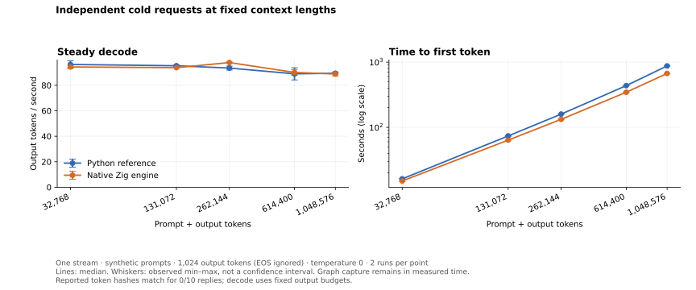

# DeepSeek-V4.1-Flash · 2× GB10 · TensorFold

**Keys abliteration · Vision · Strict JSON and tools · A large shared KV pool**

Run DeepSeek-V4.1-Flash across two NVIDIA GB10s using Mia's EXL3 weights, drowzeys' Keys overlay and Bertholomus's native Zig TP2 engine. This fork adds the recipe's context aliases, structured output, shared-pool capacity and reversible deployment controls to that engine.

**Native qualification is in progress.** The configured targets below are not native hardware qualification or performance claims. The previous Python deployment remains the rollback reference; see [migration gates](MIGRATION.md).

| Configuration target | Setting |
|---|---|
| Shared KV pool | **8,650,752 logical tokens** shared by active and retained sessions |
| Concurrent active slots | **32** |
| Maximum context | **1,048,576 tokens per request**, prompt plus reply |
| Context aliases | **262,144 / 524,288 / 614,400 / 1,048,576** tokens |
| Features under qualification | Vision, Keys, strict JSON/schema/tools, random and explicit request seeds |
| Session KV writes to NVMe | **Off** |

Slots and maximum context are separate limits: 32 slots do not mean 32 simultaneously full million-token histories. [Fresh Python reference measurements](deployment/release/native-python-baseline-20261010.json) and [historical benchmarks](benchmarks/README.md) must not be read as native results.

[Credits](#credits) · [Setup](#setup) · [Rollback](#rollback) · [Development](#development) · [License](#license)

## Author's anecdote

I have personally been using this with model aliases suffixed with `-1m` and `-262k` (variants differing only in context window) configured in my coding agent: `-1m` interactively and `-262k` for 32 parallel sessions, and I've been seeing ~140 aggregate tok/s for long-running code review/refactor agent sessions. As far as I know, this is the only dual GB10 recipe for this model that supports this (C32 at full 262k) as of today, 2026-10-08.

This dated observation describes the previous Python deployment. [Native measurements and limits](MIGRATION.md#deep-context-matched-measurements-on-the-corrected-image) are reported separately.

## Credits

This work builds on the following projects and contributors:

| Contributor | Contribution |
|---|---|
| [ashhart / TensorFold contributors](https://github.com/ashhart/TensorFold) | TensorFold framework, EXL3 foundation and inherited kernels |
| [Bertholomus / Albert Lee](https://github.com/bertholomus/TensorFold/tree/deepseek-v41-tp2) | DeepSeek TP2 native Zig engine, vision/RDMA integration, benchmark kit and CUDA kernels; earlier Python correctness and memory improvements |
| [Capicua25x](https://github.com/bertholomus/deepseek-v4.1-tensorfold-tp2-2xgb10/pull/9) | Novelty signal used by Bertholomus's optional reasoning-loop guard |
| [Mia-AiLab](https://huggingface.co/Mia-AiLab/DeepSeek-V4.1-Flash-EXL3-2.9bpw) | EXL3 2.9-bpw checkpoint |
| [drowzeys / Keys](https://huggingface.co/drowzeys/DeepSeek-V4.1-Flash-Abliterated-Cybersecurity-Unleashed) | Matching Keys attention overlay |
| [DeepSeek](https://huggingface.co/deepseek-ai/DeepSeek-V4.1-Flash) | Original model, assets and model research |
| [Urtho](https://github.com/urtho/TensorFold) | Adapted structured-output/DRM work and approaches to graph and memory budgeting |
| [Jay Leaton](https://github.com/jayleaton/deepseek-v41-tensorfold-spark) | Parsing/grammar work adapted through Urtho, with its MIT notice retained |
| [coolbho3k / Emi Huang](https://github.com/coolbho3k/DeepSeek-v4.1-Flash-2x-DGX-Spark) | vLLM recipe reference and the display-memory idea credited by Urtho's independent DRM implementation |
| Soumyarup Sarkar | Local integration, sampling controls, capacity/retention policies, diagnostics, measured draft policy, reversible deployment tools and publication preparation |

Performance results describe the combined system. [Detailed attribution and source pins](deployment/COMPARISON.md#attribution), [native family provenance](tools/dsv41-zig/ATTRIBUTION.md) and [third-party notices](THIRD_PARTY_NOTICES.md) identify adapted code and its origins.


The native grammar bridge uses [MLC-AI xgrammar](https://github.com/mlc-ai/xgrammar) directly from C++; [Zig](https://ziglang.org/) supplies the compiler and standard library. Their pinned revisions and retained notices are included with this source.

## Setup

Run the controller on the head node; it manages the worker over verified SSH. The [full native installation runbook](deployment/README.md) describes fresh acquisition, verified asset reuse, storage and recovery. Use an otherwise idle pair and preserve the prior installation during migration.

### Prerequisites

- Two GB10 Linux/systemd hosts with compatible NVIDIA drivers and Docker with NVIDIA GPU support.
- Python 3.12+, rsync, SSH, noninteractive sudo, `ip`, `ibv_devinfo`, `nvidia-smi`, systemd and module tools on both hosts; Git on the head.
- Two working RoCE rails with stable IPv4 addresses, Ethernet MTU 9000 and active RDMA MTU 4096.
- At least 112 GiB `MemAvailable` per host before loading. The profile temporarily takes over the NVIDIA display.
- Dedicated writable data roots. Fresh acquisition needs roughly 724 GB on the head and 520 GB on the worker, plus the approximately 24.5 GB image, build/download scratch space, logs and margin. These are decimal GB.
- Access to the [pinned model assets](deployment/config/assets.json), using an external read-only HF token file if required.

Host CUDA development packages, host NCCL and host Zig are unnecessary: build and inference dependencies are containerized. Routine recipe start/stop requires no reboot. Prerequisite package, credential and network changes are outside recipe rollback.

### Configure and capture the baseline

```bash
cp deployment/config/cluster.example.json deployment/local.json
# Edit the file for your pair before init.
python3 cluster plan
python3 cluster doctor
python3 cluster init
```

Set the worker SSH target, each host's data root and rail names/addresses, API bind/port and rendezvous port. Set `allow_temporary_drm=true` after reviewing [rollback](#rollback). The API defaults to loopback; choosing a LAN bind also requires `api.allow_unauthenticated_lan=true`. There is no API authentication.

`plan` has no host side effects. `doctor` reads host and network state. `init` creates installation ownership and captures both host baselines. Preserve the ignored `deployment/local.json` and the complete `deployment/.local/` directory. Later configuration drift is refused.

### Acquire and verify assets

If needed, set `HF_TOKEN_PATH` to an existing token file outside the checkout. The token is not included in the image or serving containers.

```bash
python3 cluster fetch
python3 cluster replicate
python3 cluster verify
```

Acquisition pins immutable weights, the 104 Keys tensor overrides, Engram/vision assets and the native kernel kit. The [reuse path](deployment/README.md#acquire-verified-inputs) can instead hardlink verified compatible assets from a retained installation without copying private journals or mutable caches. Shared files must remain immutable.

### Build and start

Keep the tracked checkout clean and committed. Run each step only after its predecessor succeeds:

```bash
python3 cluster build
python3 cluster prepare
python3 cluster precompile
python3 cluster start
python3 cluster status
```

`build` verifies the compiler pin, runs CPU/server and C++ grammar tests and installs the same image on both hosts. `prepare` creates missing rank caches with a CPU-only native writer and prepares the Engram token map. `precompile` exercises GPU primitives and router widths, then independently compares every prepared tensor byte to the intended checkpoint. Existing completed caches are not overwritten.

`start` verifies both hosts, journals temporary display/module settings, and launches the worker, head and paired monitor. The monitor stops both ranks after repeated health/memory failures or stalled progress. A poisoned rank pair requires a coordinated restart; no inference service is enabled at boot.

With the default bind and port:

```bash
curl --fail http://127.0.0.1:8000/v1/chat/completions \
  -H 'Content-Type: application/json' \
  -d '{"model":"DeepSeek-V4.1-Flash-Keys-262k","messages":[{"role":"user","content":"What is 12 times 13?"}],"max_tokens":64}'
```

Use your configured address/port if different. The `-262k`, `-524k`, `-614k` and `-1m` aliases differ only in the allowed prompt-plus-reply window. See [sampling and replay](deployment/SAMPLING.md).

## Rollback

```bash
python3 cluster stop
python3 cluster check-host
```

Stop removes this installation's serving containers and restores its journaled host state. It retains downloaded assets, caches, source, images and receipts. Keep every file in `deployment/.local/` until restoration succeeds; Git does not back up this ignored state.

If the configuration changed, use the saved original:

```bash
python3 cluster --config deployment/.local/installed.json stop
python3 cluster --config deployment/.local/installed.json check-host
```

If a host is unreachable, recover it and retry with the same journals. After a reboot, the controller compares state without imposing stale current-boot settings. Preserve failed restoration evidence. [Full rollback](deployment/ROLLBACK.md) and [migration rollback](deployment/MIGRATION-ROLLBACK.md) cover updates and returning to a retained Python installation. Never overwrite current recovery journals with backup copies.

## Native changes and limits

- Independently sized request windows and shared KV pool, with 32 slots, bounded retained checkpoints and live extent compaction.
- Native DRM-backed KV allocation, bounded graph caching with eager fallback, and measured engine/host diagnostics.
- Batched drafting, verifier and communication bounds checked independently; router rounds wider than 16 rows use validated slices of the pinned AOT kernels.
- A C++ xgrammar bridge for JSON objects, schemas, required/named tool calls and guided formats. Constrained requests use ordinary decoding.
- Configurable prompt-derived or random request seeding. The deployment chooses random; explicit seeds support replay.
- Pinned image/asset identities, read-only model mounts, paired failure handling and journaled current-boot host restoration.

Session KV histories are not written to NVMe. Prepared weights, compiler/driver caches and bounded operational logs still write to storage. Python remains for orchestration, offline token-map preparation and the bounded image-codec helper; model execution, scheduling and sampling run in Zig/CUDA.

## Native context measurements



Two cold synthetic requests per engine and context, each generating 1,024 tokens at temperature 0. At a million tokens, median steady decode was **88.8 tok/s native versus 89.4 Python**; first token arrived in **670 s versus 875 s**. These are independent fixed-length requests. The generated replies differ between engines, so the graph compares matched prompts and output budgets rather than identical generated decode work.

The tradeoff is workload-dependent: the C32 short-prompt confirmation measured **141.2 versus 153.2 aggregate end-to-end tok/s** (six native runs versus the original two Python runs). The measured-benefit gate accepts faster deep prefill with this cost disclosed; recovery and endurance qualification remain open. [All repetitions, methods and limits](MIGRATION.md#deep-context-matched-measurements-on-the-corrected-image) · [JSON data](release/native-deep-comparison-20261010.json) · [PNG](release/figures/native-deep-context-20261010.png).

## Development

Use separate development and pinned serving checkouts. Keep the active checkout at its recorded path. Update it only after stopping and verifying host restoration, preserving the old source, image, configuration, journals and assets.

Portable checks need Python's standard library and do not contact either host:

```bash
python3 -B -m unittest discover -s tests/publication -v
python3 -B -m unittest discover -s deployment/tests -v
python3 -B scripts/check_release.py
python3 -B cluster --config deployment/config/cluster.example.json plan
```

The ARM64 Linux CI job additionally verifies the pinned Zig compiler and xgrammar revision, runs native CPU/server tests and checks the C++ grammar bridge. It downloads build dependencies, not model weights, and makes no GPU inference claim. Paired hardware qualification remains separate. [Contributing](CONTRIBUTING.md) · [Security](SECURITY.md).

## License

Source licensing and retained notices are in [LICENSE](LICENSE), [NOTICE](NOTICE), [THIRD_PARTY_NOTICES.md](THIRD_PARTY_NOTICES.md) and [native family attribution](tools/dsv41-zig/ATTRIBUTION.md).

Weights, overlays and the NVIDIA container base have their own terms. This repository distributes source and asset references; model files and container images are acquired separately.
